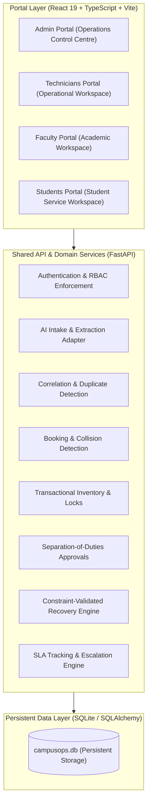

# CampusOps · Architecture Blueprint

## 1. System Vision & Paradigm
CampusOps is engineered as a unified operations engine with four specialized role experiences backed by a single persistent SQLite database and shared state machine services. 

Rather than four isolated mockup dashboards, all portals (Admin, Technicians, Faculty, Students) interact with identical real-time records:
- A **Student** reports a broken Wi-Fi router in Computer Lab A before an exam.
- The **AI & Intake Adapter** extracts location, urgency, and matches it against campus records.
- **Faculty** immediately sees the affected room status on their timetable view.
- **Admin** monitors the incident correlation, SLA counter, and triggers the Disruption Recovery Engine.
- A **Technician** receives the skill-matched work order on their mobile/web queue and updates repair diagnostics.

---

## 2. Multi-Layer Platform Architecture

---

## 3. Layer Responsibilities

| Layer | Responsibilities |
| :--- | :--- |
| **Portal Layer** | Admin Portal · Technicians Portal · Faculty Portal · Students Portal. Enforces usability guards, role-adapted navigation, live status badges, and interactive modals. |
| **Shared API / Service Layer** | Authentication and RBAC · AI intake · incident correlation · workflow/state engine · assignment and scheduling · booking and inventory controls · approvals · SLA and escalation · notifications · audit events. |
| **Persistent Data Layer** | Users and roles · campus hierarchy · rooms and bookings · staff, skills and shifts · assets · complaints and incidents · work orders · inventory and reservations · approvals · notifications · audit events. |

---

## 4. Architectural Safety Rules & Concurrency

1. **Backend Validation First**: The frontend hides unavailable actions for usability, but the backend independently validates every privileged operation.
2. **Separation of Duties**: System administration does not automatically grant business approval authority. Requesters cannot approve their own purchase requests.
3. **Transactional Integrity**: Database transactions and row locks are used for room bookings and parts reservations to prevent double-booking and over-reservation.
4. **State Machine Transitions**: Transitions are guarded by finite state machines recording actor identity, timestamp, and audit trail.
5. **Freshness & Fresh Status**: Stale status indicators are timestamped and never presented as confirmed real-time readiness without inspection signoff.

