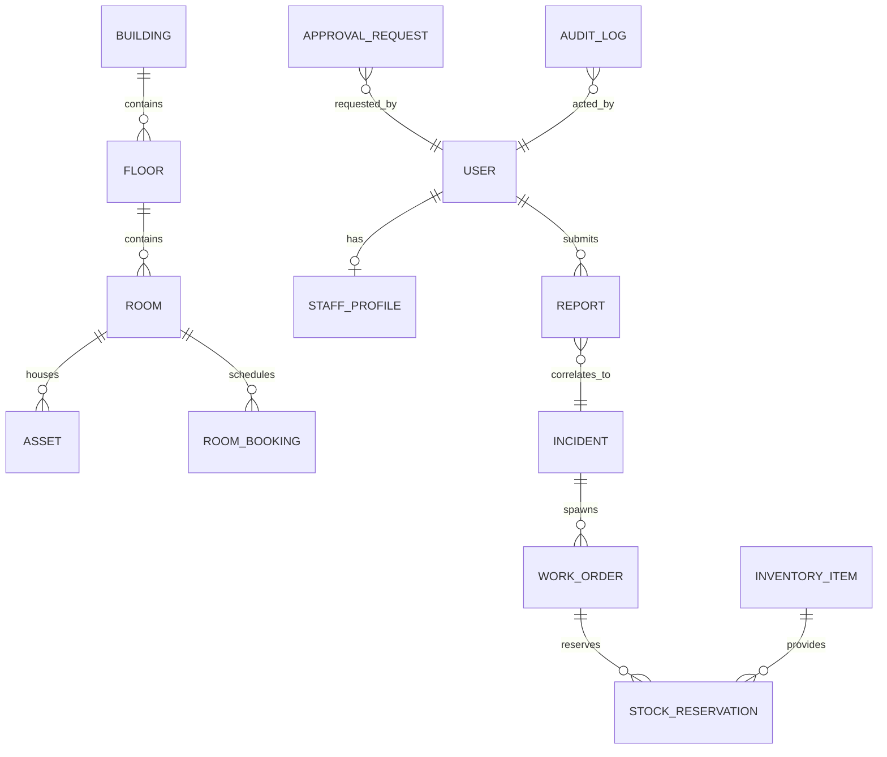

# CampusOps · Database Schema Documentation

Database Engine: **SQLite 3** (`backend/data/campusops.db`)  
ORM Layer: **SQLAlchemy 2.0**

---

## Entity Relationship Overview

---

## Core Tables & Attributes

### 1. `buildings` & `floors`
- **buildings**: `id` (UUID PK), `name` (unique), `code` (unique, e.g. ENG, SCI), `total_floors`, `description`, `created_at`
- **floors**: `id` (UUID PK), `building_id` (FK), `floor_number`, `name`, `created_at`

### 2. `rooms`
- `id` (UUID PK), `building_id` (FK), `floor_id` (FK), `room_number` (e.g. ENG-101), `name` (Computer Lab A), `type` (classroom, lab, exam_hall), `capacity` (int), `features` (JSON string array), `status` (available, under_maintenance, unavailable), `daily_readiness_status` (confirmed, stale, unconfirmed), `readiness_checked_at`, `readiness_checked_by`

### 3. `assets`
- `id` (UUID PK), `asset_tag` (unique), `name`, `category` (network, av_equipment, hvac, electrical, lab_equipment), `building_id`, `room_id`, `status` (operational, degraded, maintenance), `serial_number`, `last_inspected_at`

### 4. `users` & `staff_profiles`
- **users**: `id` (UUID PK), `email` (unique index), `hashed_password`, `name`, `role` (admin, technician, faculty, student), `sub_role` (department_manager, facilities_admin, procurement_approver, system_admin, floor_incharge, maintenance_technician, janitor, room_incharge), `department`, `building_id`, `floor_id`, `is_active`
- **staff_profiles**: `id` (UUID PK), `user_id` (unique FK), `skills` (JSON array), `shift` (morning, evening, night), `assigned_building_id`, `assigned_floor_id`, `availability_status` (available, on_task, absent), `current_workload` (int)

### 5. `reports` & `incidents`
- **reports**: `id` (UUID PK), `report_code` (unique), `title`, `description`, `category`, `urgency`, `building_id`, `room_id`, `asset_id`, `reporter_id`, `reporter_role`, `source` (web_portal, simulated_email), `status` (submitted, triaged, correlated, resolved), `incident_id` (nullable FK), `ai_extracted_meta` (JSON)
- **incidents**: `id` (UUID PK), `incident_code` (unique), `title`, `description`, `category`, `severity`, `priority` (P1-P4), `building_id`, `room_id`, `asset_id`, `status` (open, in_progress, pending_parts, pending_approval, resolved, closed), `sla_due_at`, `is_sla_breached`, `correlated_count`, `summary`, `resolved_at`

### 6. `work_orders`
- `id` (UUID PK), `work_order_code`, `incident_id` (FK), `title`, `description`, `assigned_technician_id` (FK), `priority`, `status` (assigned, in_progress, blocked, pending_parts, completed), `required_skills` (JSON), `sla_deadline`, `blocked_reason`, `diagnosis`, `checklist` (JSON), `evidence_notes`, `completed_at`

### 7. `room_bookings`
- `id` (UUID PK), `booking_code`, `room_id` (FK), `user_id` (FK), `user_role`, `title`, `purpose` (lecture, lab_session, examination, seminar), `start_time`, `end_time`, `status` (confirmed, relocated, cancelled), `equipment_required` (JSON), `conflict_resolved_to_room_id`

### 8. `inventory_items` & `stock_reservations`
- **inventory_items**: `id` (UUID PK), `item_code`, `name`, `category`, `stock_quantity`, `reserved_quantity`, `unit_cost`, `minimum_threshold`
- **stock_reservations**: `id` (UUID PK), `work_order_id`, `item_id`, `quantity`, `status` (reserved, consumed, cancelled)

### 9. `approval_requests` & `procurement_requests`
- **approval_requests**: `id` (UUID PK), `approval_type` (purchase, costly_repair, room_override), `target_entity_type`, `target_entity_id`, `requester_id`, `approver_id`, `status` (pending, approved, rejected), `cost_amount`, `justification`, `decision_reason`, `decided_at`
- **procurement_requests**: `id` (UUID PK), `request_code`, `item_id`, `quantity`, `estimated_cost`, `work_order_id`, `requester_id`, `status`

### 10. `notifications` & `audit_logs`
- **notifications**: `id`, `recipient_id`, `recipient_role`, `title`, `message`, `type`, `read`, `link_url`, `created_at`
- **audit_logs**: `id`, `action`, `actor_id`, `actor_role`, `entity_type`, `entity_id`, `old_value`, `new_value`, `reason`, `idempotency_key`, `created_at`

